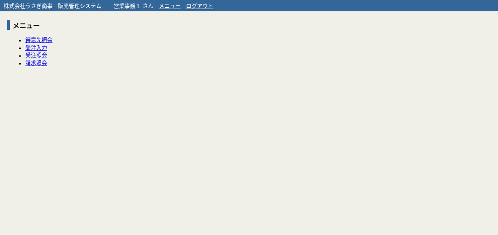
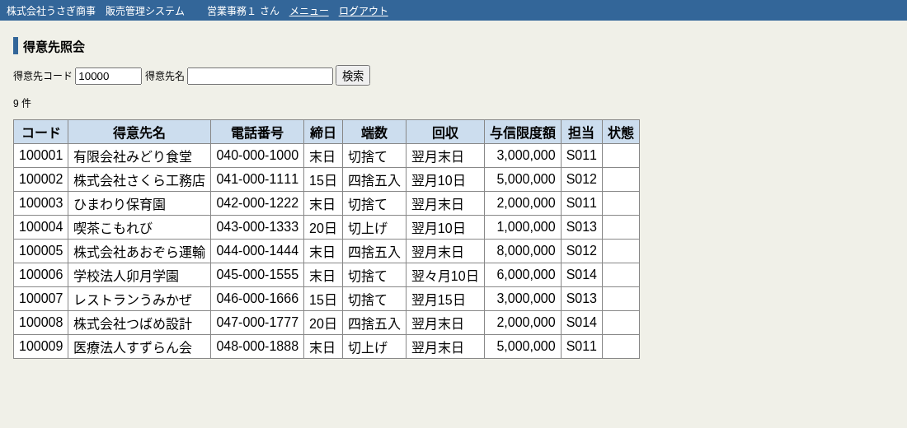
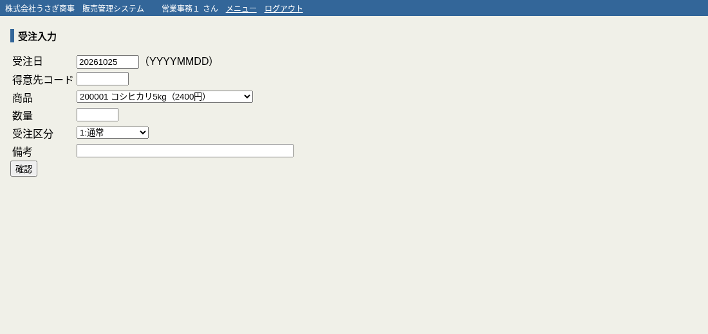
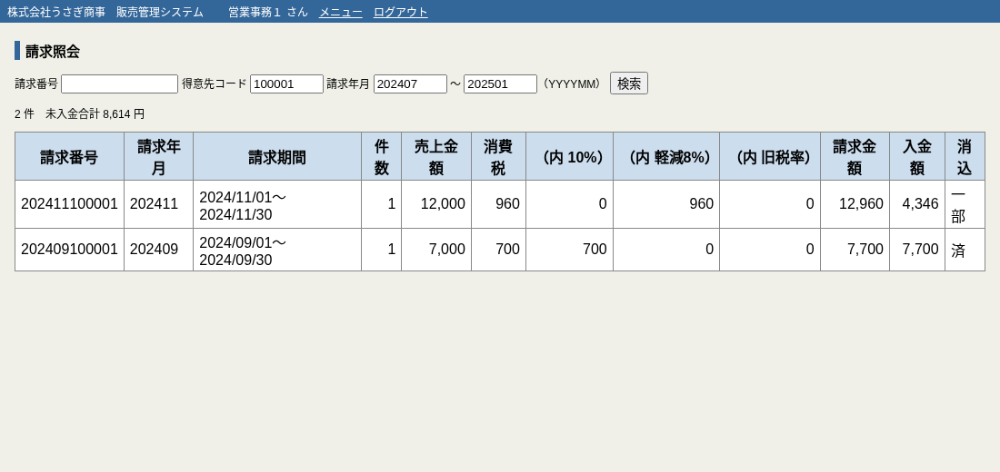

# うさぎ商事 販売管理システム

株式会社うさぎ商事（架空）の販売・請求システムです。

- 夜間バッチ：COBOL（1990年代〜）。売上計上・消費税計算・請求締め・入金消込・月次集計・帳票出力
- Web 画面：Java（2005年〜）。Struts 1.3 / JSP / Tomcat 8.5 / Java 8 / PostgreSQL

## ディレクトリ

| パス | 内容 |
|---|---|
| `web/` | Web 画面（Java ソース、JSP、Struts 設定、docker compose、DDL・データ投入 SQL） |
| `batch/` | 夜間バッチ（COBOL、コピー句、JCL、入力データ） |
| `docs/` | 旧仕様書、帳票サンプル |

## 画面の起動

```
cd web
docker compose up
```

ブラウザで http://localhost:8080/usagi/ を開き、`user01` / `usagi01` でログインします。

## 画面

メニュー



得意先照会



受注入力



請求照会


