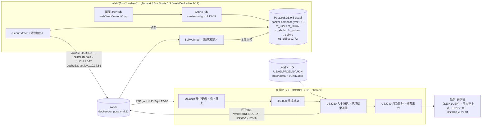

# 00 全体地図（システム構成・業務イベント一覧・プログラム一覧）

対象: `natt-cog/usagi-sales-legacy`（初期登録コミット e96711b）。根拠はすべて「ファイル名:行番号」で記す。推定した記述には「推定」と理由を書く。

## 1. システム構成

| 層 | 技術 | 根拠 |
|---|---|---|
| 画面 | JSP + Struts 1.3.10（ActionServlet `*.do`） | web.xml:19-31、WEB-INF/lib/struts-core-1.3.10.jar |
| DB | PostgreSQL 9.6、JDBC 直書き（DBUtil） | docker-compose.yml:3、DBUtil.java:11-23 |
| Web 側バッチ | Java main クラス 2本（JuchuExtract / SeikyuImport） | JuchuExtract.java:13、SeikyuImport.java:14 |
| ファイル連携 | 固定長ファイルを FTP（binary）で送受信 | USJ010.jcl:12-20、USJ030.jcl:28-34 |
| 夜間バッチ | COBOL 9本・コピー句5本（1本欠落）・JCL 4本 | batch/cobol, batch/copy, batch/jcl |

## 2. 業務イベント一覧

| ID | 業務イベント | 起点 | 主なプログラム | 根拠 |
|---|---|---|---|---|
| EV01 | ログイン・ログアウト | 画面 | LoginAction / LogoutAction / MenuAction | struts-config.xml:14-24 |
| EV02 | 得意先照会・メンテナンス | 画面 | TokuiSearchAction / TokuiEditAction | struts-config.xml:25-30 |
| EV03 | 受注入力 | 画面 | JuchuInputAction → JuchuConfirmAction → JuchuRegistAction | struts-config.xml:31-43 |
| EV04 | 受注照会 | 画面 | JuchuInquiryAction | struts-config.xml:44-46 |
| EV05 | 売上計上（受注抽出→売上ファイル作成） | 夜間 | JuchuExtract → USJ010（SORT・USB100・USB110） | USJ010.jcl:5-37 |
| EV06 | 月次請求締め | 夜間 | USJ020（USB200・USB210） | USJ020.jcl:5-21 |
| EV07 | 入金消込・請求結果連携 | 夜間 | USJ030（SORT・USB300・FTP）→ SeikyuImport | USJ030.jcl:5-34 |
| EV08 | 請求照会 | 画面 | SeikyuInquiryAction | struts-config.xml:47-49 |
| EV09 | 月次集計・帳票出力（請求書・月次売上表） | 夜間 | USJ040（USB400・USR500・USR510） | USJ040.jcl:5-35 |

## 3. プログラム一覧

| No | 業務プログラム名 | プログラムID | 種別 | 起動元 | 根拠 |
|---|---|---|---|---|---|
| P01 | ログイン認証 | LoginAction | Action | /login.do | struts-config.xml:14 |
| P02 | ログアウト | LogoutAction | Action | /logout.do（header.jsp:4） | struts-config.xml:19 |
| P03 | メニュー表示 | MenuAction | Action | /menu.do | struts-config.xml:22 |
| P04 | 得意先照会 | TokuiSearchAction | Action | /tokuiSearch.do | struts-config.xml:25 |
| P05 | 得意先メンテナンス | TokuiEditAction | Action | /tokuiEdit.do | struts-config.xml:28 |
| P06 | 受注入力（初期表示） | JuchuInputAction | Action | /juchuInput.do | struts-config.xml:31 |
| P07 | 受注入力（確認・入力チェック） | JuchuConfirmAction | Action | /juchuConfirm.do | struts-config.xml:35 |
| P08 | 受注登録 | JuchuRegistAction | Action | /juchuRegist.do | struts-config.xml:40 |
| P09 | 受注照会 | JuchuInquiryAction | Action | /juchuInquiry.do | struts-config.xml:44 |
| P10 | 請求照会 | SeikyuInquiryAction | Action | /seikyuInquiry.do | struts-config.xml:47 |
| P11 | 受注抽出（Web→夜間バッチ） | JuchuExtract | Java バッチ | 不明（起動シェルなし） | JuchuExtract.java:13 |
| P12 | 請求取込（夜間バッチ→Web） | SeikyuImport | Java バッチ | 不明（起動シェルなし） | SeikyuImport.java:14 |
| P13 | 売上計上 | USB100 | COBOL | USJ010 STEP020 | USJ010.jcl:31 |
| P14 | 消費税計算（サブ） | USB110 | COBOL | USB100 から CALL | USB100.cbl:112 |
| P15 | 月次請求締め | USB200 | COBOL | USJ020 STEP010 | USJ020.jcl:12 |
| P16 | 締日算出（サブ） | USB210 | COBOL | USB200 から CALL | USB200.cbl:89 |
| P17 | 入金消込 | USB300 | COBOL | USJ030 STEP020 | USJ030.jcl:21 |
| P18 | 月次売上集計（得意先別） | USB400 | COBOL | USJ040 STEP010 | USJ040.jcl:12 |
| P19 | 請求書発行 | USR500 | COBOL | USJ040 STEP020 | USJ040.jcl:17 |
| P20 | 月次売上表出力 | USR510 | COBOL | USJ040 STEP030 | USJ040.jcl:27 |
| P21 | 消費税再計算（税率改定対応） | USB900 | COBOL | なし（未使用） | USB900.cbl:1-10 |
| ― | 共通部品 DBUtil / EncodingFilter | ― | 共通 | 各 Action / web.xml:7-18 | DBUtil.java:9 |

JCL 4本（USJ010〜USJ040）、コピー句 6本参照（うち NYKREC は欠落、USB300.cbl:29）、JSP 9本＋header.jsp、テーブル 5本、固定長ファイル 9種。

## 4. 設計書一覧

| No | 設計書 | ファイル | 件数 |
|---|---|---|---|
| 1 | プログラム仕様書 | [01_プログラム仕様書.md](01_プログラム仕様書.md)（Excel「プログラム一覧」「プログラム仕様書」） | 21本 |
| 2 | プログラム処理フロー図 | [02_プログラム処理フロー図.md](02_プログラム処理フロー図.md) | 21図 |
| 3 | アプリケーション詳細設計書 | [03_アプリケーション詳細設計書.md](03_アプリケーション詳細設計書.md) | 9業務イベント |
| 4 | 処理フローシーケンス図 | [04_処理フローシーケンス図.md](04_処理フローシーケンス図.md) | 9図 |
| 5 | 呼出し関係ツリー図 | [05_呼出し関係ツリー図.md](05_呼出し関係ツリー図.md) | 2図（JCL系・画面系） |
| 6 | CRUD図 | [06_CRUD図.md](06_CRUD図.md)（Excel「CRUD図」） | 21行 × 19テーブル・ファイル |
| ― | 欠けた資産と復元案 | [07_欠けた資産と復元案.md](07_欠けた資産と復元案.md) | 8件 |
| ― | 旧仕様書との差分 | [08_旧仕様書との差分.md](08_旧仕様書との差分.md)（Excel「旧仕様書との差分」） | 16件 |
| ― | 未使用・類似資産 | [09_未使用・類似資産.md](09_未使用・類似資産.md) | 未使用8件・類似5件 |
| ― | 確認事項一覧 | [10_確認事項一覧.md](10_確認事項一覧.md)（Excel「確認事項一覧」） | 25件 |

作成方法：ソースと資料を読むだけで作成した（プログラムは実行していない）。入出力例は docs/帳票サンプル と web/sql/02_data.sql、batch/data/NYUKIN.DAT から取り、コードから導いた値には「推定」と書いた。
