# 02 プログラム処理フロー図

> 凡例：根拠は「ファイル名:行番号」。パスは省略形（例 USB100.cbl＝batch/cobol/USB100.cbl、JuchuRegistAction.java＝web/src/jp/co/usagi/sales/action/JuchuRegistAction.java、02_data.sql＝web/sql/02_data.sql、旧仕様書.xlsx＝docs/旧仕様書.xlsx）。「推定」と書いたものはコードから確定できない記述で、理由を併記する。

ノード内の「:NN」は同じソースの行番号。

## P01 ログイン認証（LoginAction）

ソース：web/src/jp/co/usagi/sales/action/LoginAction.java

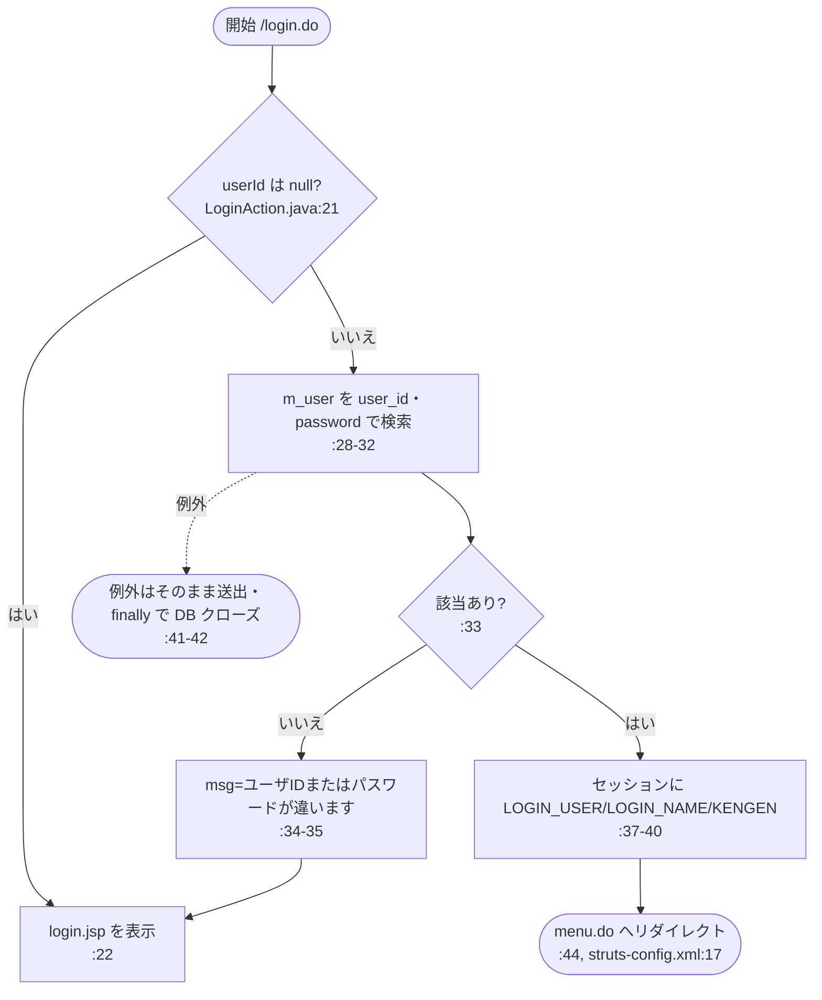

## P02 ログアウト（LogoutAction）

ソース：web/src/jp/co/usagi/sales/action/LogoutAction.java

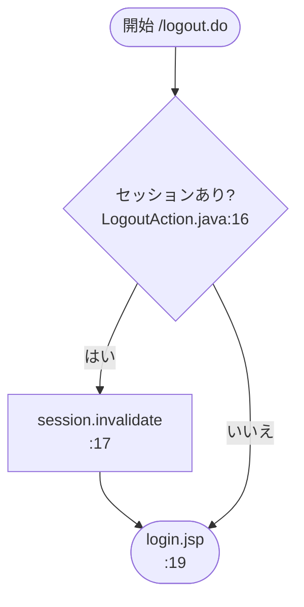

## P03 メニュー表示（MenuAction）

ソース：web/src/jp/co/usagi/sales/action/MenuAction.java

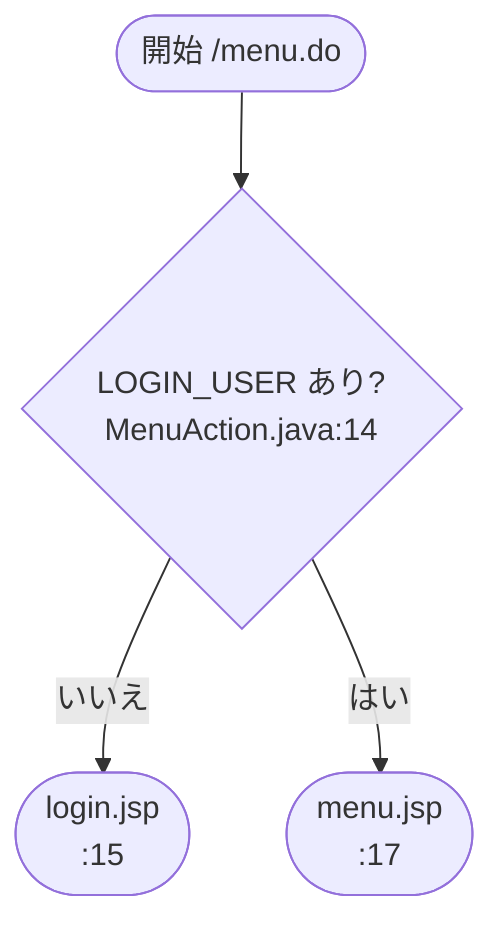

## P04 得意先照会（TokuiSearchAction）

ソース：web/src/jp/co/usagi/sales/action/TokuiSearchAction.java

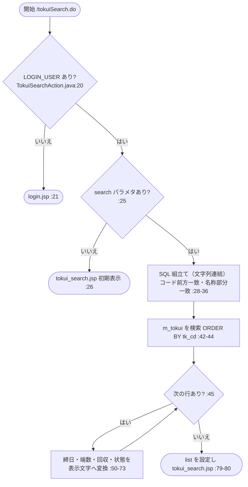

## P05 得意先メンテナンス（TokuiEditAction）

ソース：web/src/jp/co/usagi/sales/action/TokuiEditAction.java

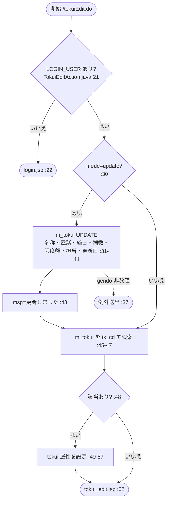

## P06 受注入力（初期表示）（JuchuInputAction）

ソース：web/src/jp/co/usagi/sales/action/JuchuInputAction.java

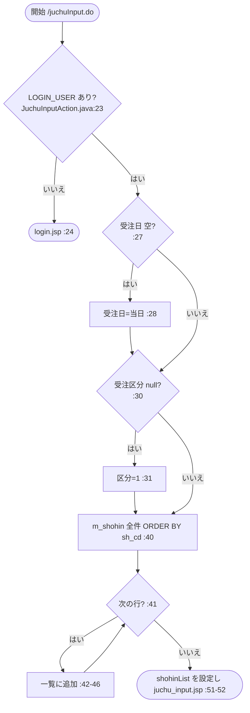

## P07 受注入力チェック・確認表示（JuchuConfirmAction）

ソース：web/src/jp/co/usagi/sales/action/JuchuConfirmAction.java, web/WebContent/juchu_confirm.jsp

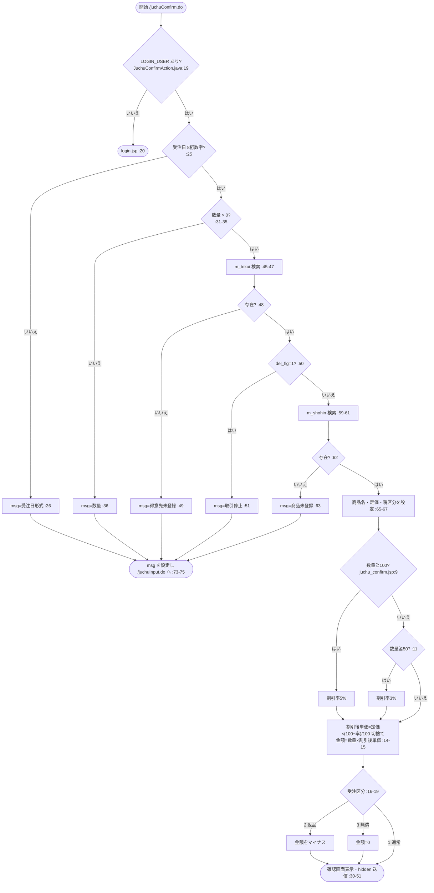

## P08 受注登録（JuchuRegistAction）

ソース：web/src/jp/co/usagi/sales/action/JuchuRegistAction.java

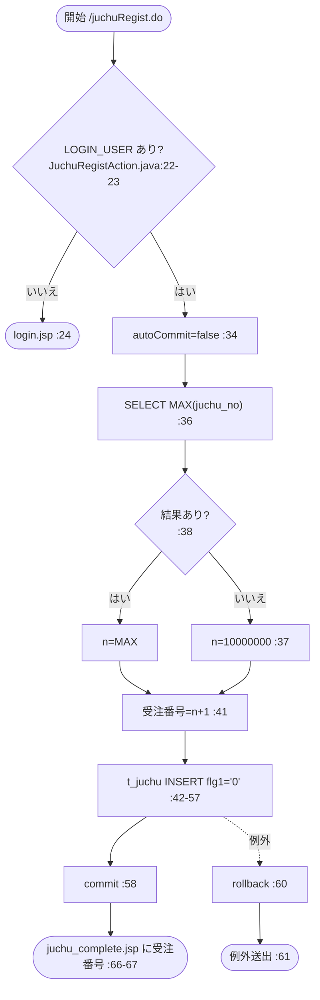

## P09 受注照会（JuchuInquiryAction）

ソース：web/src/jp/co/usagi/sales/action/JuchuInquiryAction.java, web/WebContent/juchu_inquiry.jsp

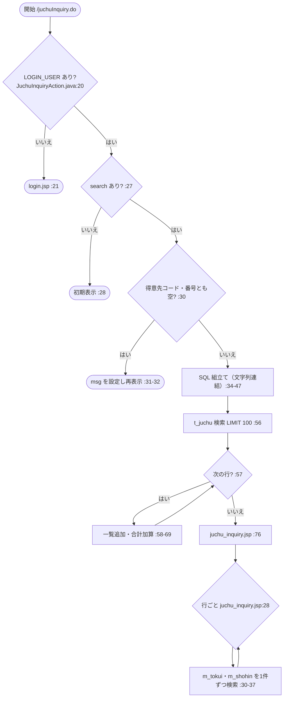

## P10 請求照会（SeikyuInquiryAction）

ソース：web/src/jp/co/usagi/sales/action/SeikyuInquiryAction.java, web/WebContent/seikyu_inquiry.jsp

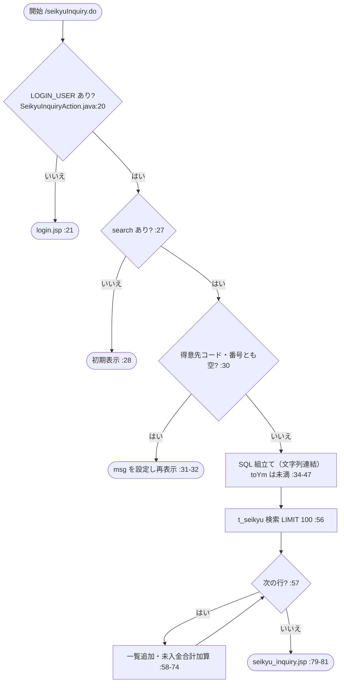

## P11 受注抽出（Web→夜間バッチ連携ファイル作成）（JuchuExtract）

ソース：web/src/jp/co/usagi/batch/JuchuExtract.java

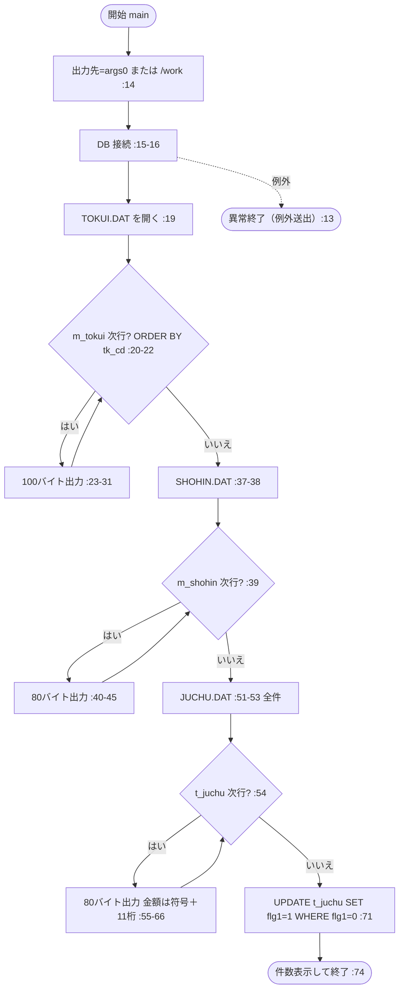

## P12 請求取込（夜間バッチ→Web）（SeikyuImport）

ソース：web/src/jp/co/usagi/batch/SeikyuImport.java

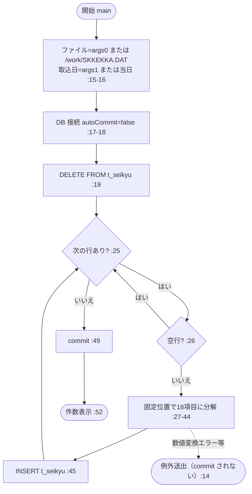

## P13 売上計上（USB100）

ソース：batch/cobol/USB100.cbl

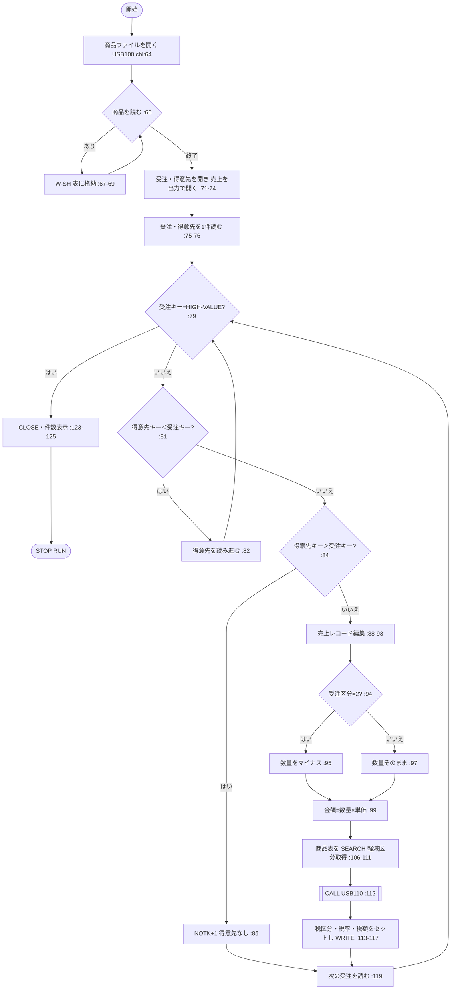

## P14 消費税計算（サブ）（USB110）

ソース：batch/cobol/USB110.cbl

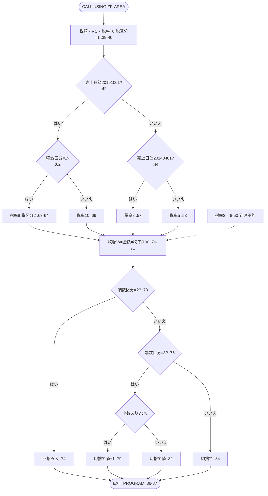

## P15 月次請求締め（USB200）

ソース：batch/cobol/USB200.cbl

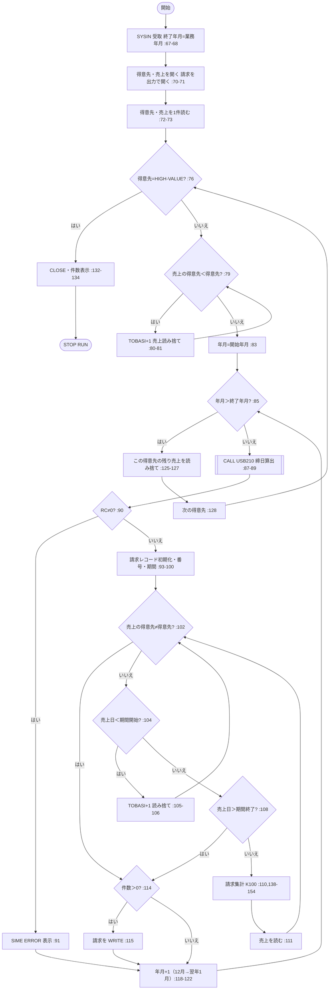

## P16 締日算出（サブ）（USB210）

ソース：batch/cobol/USB210.cbl

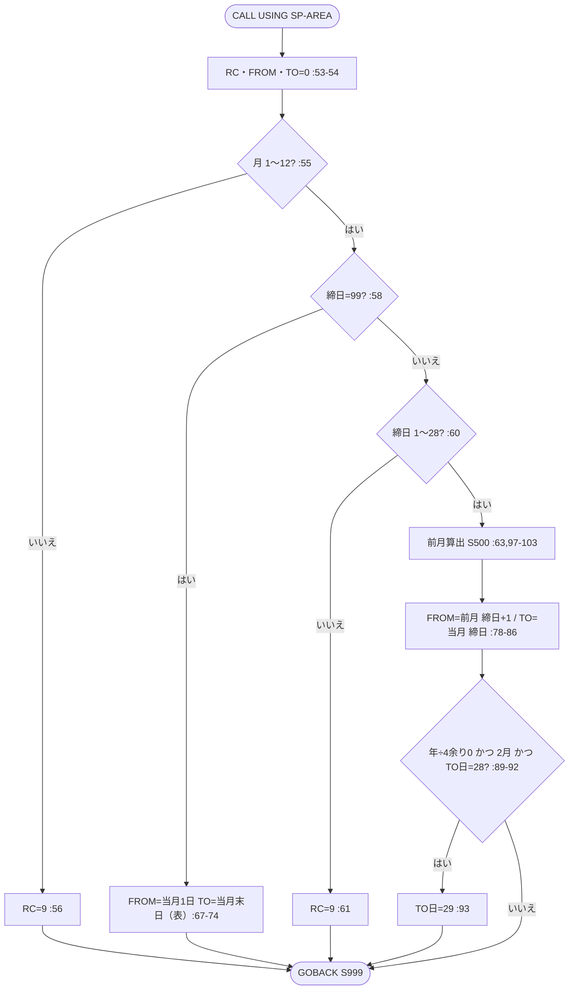

## P17 入金消込（USB300）

ソース：batch/cobol/USB300.cbl

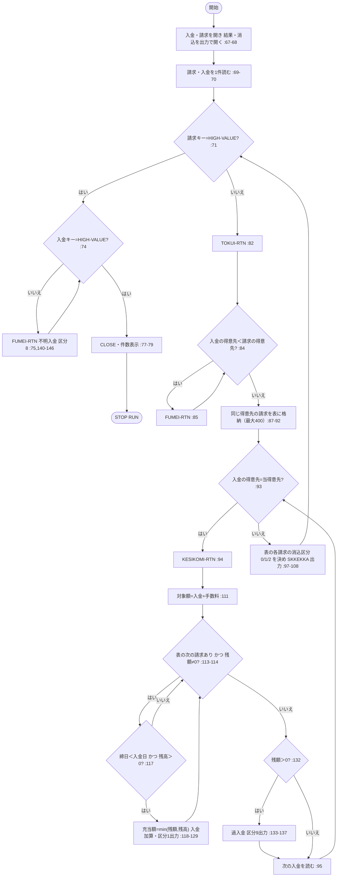

## P18 得意先別月次売上集計（USB400）

ソース：batch/cobol/USB400.cbl

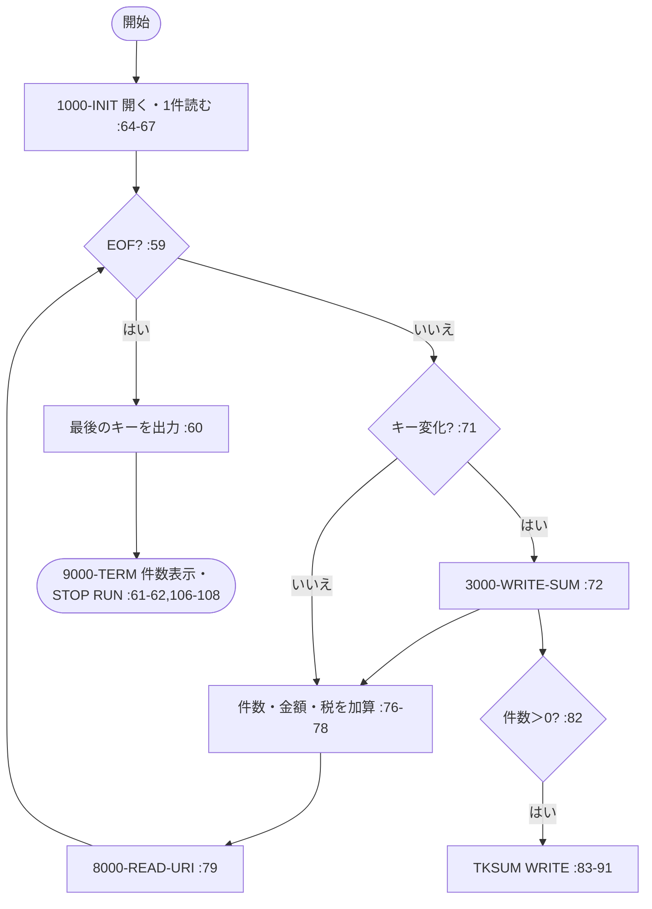

## P19 請求書発行（USR500）

ソース：batch/cobol/USR500.cbl

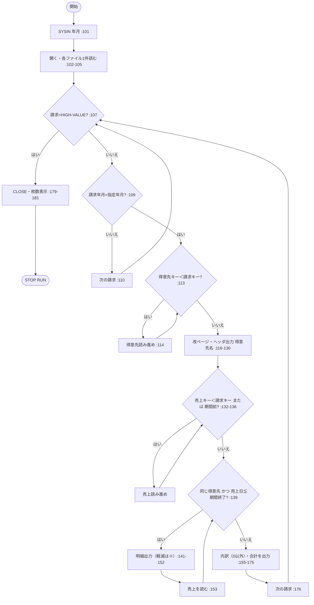

## P20 月次売上表出力（USR510）

ソース：batch/cobol/USR510.cbl

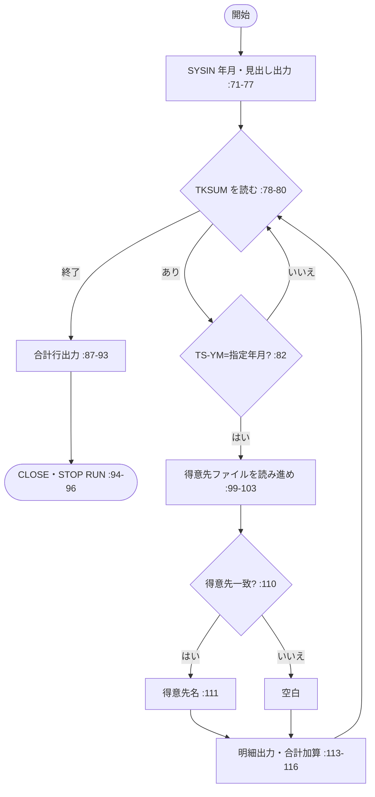

## P21 消費税再計算（税率改定対応・未使用）（USB900）

ソース：batch/cobol/USB900.cbl

```mermaid
flowchart TD
  S(["開始"]) --> O["開く :37"]
  O --> R{"売上を読む :39"}
  R -- 終了 --> E(["CLOSE・件数表示・STOP RUN :52-55"])
  R -- あり --> D{"売上日＜19970401? :41"}
  D -- はい --> W
  D -- いいえ --> T{"税率≠3? :43"}
  T -- はい --> W
  T -- いいえ --> U["税率5・税額再計算 :45-48"] --> W
  W["URINEW へ WRITE :50"] --> R
```
