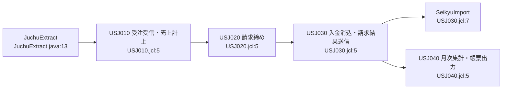

# 03 アプリケーション詳細設計書（業務イベント単位）

> 凡例：根拠は「ファイル名:行番号」。パスは省略形（例 USB100.cbl＝batch/cobol/USB100.cbl、JuchuRegistAction.java＝web/src/jp/co/usagi/sales/action/JuchuRegistAction.java、02_data.sql＝web/sql/02_data.sql、旧仕様書.xlsx＝docs/旧仕様書.xlsx）。「推定」と書いたものはコードから確定できない記述で、理由を併記する。

## 業務イベント一覧

| ID | 業務イベント | 関連プログラム |
|---|---|---|
| EV01 | ログイン・メニュー | P01 LoginAction, P02 LogoutAction, P03 MenuAction |
| EV02 | 得意先照会・メンテナンス | P04 TokuiSearchAction, P05 TokuiEditAction, P11 JuchuExtract（得意先ファイル） |
| EV03 | 受注入力 | P06 JuchuInputAction, P07 JuchuConfirmAction（＋juchu_confirm.jsp）, P08 JuchuRegistAction |
| EV04 | 受注照会 | P09 JuchuInquiryAction（＋juchu_inquiry.jsp） |
| EV05 | 売上計上（受注抽出→売上ファイル作成） | P11 JuchuExtract, USJ010（FTP・SORT）, P13 USB100, P14 USB110 |
| EV06 | 月次請求締め | USJ020, P15 USB200, P16 USB210 |
| EV07 | 入金消込・請求結果連携 | USJ030（SORT・FTP）, P17 USB300, P12 SeikyuImport |
| EV08 | 請求照会 | P10 SeikyuInquiryAction（＋seikyu_inquiry.jsp） |
| EV09 | 月次集計・帳票出力（請求書・月次売上表） | USJ040, P18 USB400, P19 USR500, P20 USR510 |

## 夜間バッチの流れ（全体）

推定：起動順はJCLのコメント（先行／後続）による。スケジューラ定義は存在しない（07_欠けた資産と復元案.md M07）。

## EV01 ログイン・メニュー

### 概要

- 利用者がユーザIDとパスワードでログインし、メニューから各業務画面へ進む。（LoginAction.java:29-44, menu.jsp:9-12）
- ログイン状態はセッション属性 LOGIN_USER で判定し、未ログインはログイン画面に戻す。（MenuAction.java:14-15, struts-config.xml:11）
- セッションの有効期間は60分。（web.xml:32-34）

関連プログラム：P01 LoginAction, P02 LogoutAction, P03 MenuAction

### 処理の流れ（画面→Action→DB→抽出→COBOL→帳票）

| No | 層 | 処理 | データ（CRUD） | 根拠 |
|---|---|---|---|---|
| 1 | 画面 | login.jsp でユーザID・パスワードを入力し /login.do へ POST | userId, password | login.jsp:9-12 |
| 2 | Action | LoginAction が m_user を照合 | m_user（R） | LoginAction.java:28-32 |
| 3 | Action | 成功時セッションに LOGIN_USER/LOGIN_NAME/KENGEN を保存 | セッション | LoginAction.java:37-40 |
| 4 | 画面 | /menu.do へリダイレクトし menu.jsp を表示 |  | struts-config.xml:17,23 |
| 5 | 画面 | ヘッダの「ログアウト」で /logout.do → セッション破棄 |  | header.jsp:4, LogoutAction.java:15-19 |

### プログラムをまたぐ業務ルール

| ルール | 内容 | 根拠 |
|---|---|---|
| 認証失敗 | 「ユーザIDまたはパスワードが違います」 | LoginAction.java:34 |
| 未ログイン | 全 Action で login.jsp へ | struts-config.xml:11 |
| 文字コード | 全リクエストを UTF-8 で受ける | web.xml:7-18 |

### 注意点

- パスワードは平文で保存・照合している（LoginAction.java:29, 02_data.sql:3-5）
- 権限 KENGEN は保存するだけで参照されない（LoginAction.java:40）

シーケンス図：[04_処理フローシーケンス図.md](04_処理フローシーケンス図.md#ev01)

## EV02 得意先照会・メンテナンス

### 概要

- 得意先をコード・名称で検索し、締日・端数・回収条件・与信限度額を確認する。（TokuiSearchAction.java:28-73）
- 得意先メンテナンスでは名称・電話・締日・端数・与信限度額・担当を更新する。更新内容は次回の受注抽出で夜間バッチに渡る。（TokuiEditAction.java:30-43, JuchuExtract.java:19-33）

関連プログラム：P04 TokuiSearchAction, P05 TokuiEditAction, P11 JuchuExtract（得意先ファイル）

### 処理の流れ（画面→Action→DB→抽出→COBOL→帳票）

| No | 層 | 処理 | データ（CRUD） | 根拠 |
|---|---|---|---|---|
| 1 | 画面 | menu.jsp →「得意先照会」 /tokuiSearch.do |  | menu.jsp:9 |
| 2 | Action | TokuiSearchAction が m_tokui を検索し表示文字に変換 | m_tokui（R） | TokuiSearchAction.java:28-73 |
| 3 | 画面 | /tokuiEdit.do?tkCd=… を直接開く（リンクなし） |  | tokui_edit.jsp:10-11 |
| 4 | Action | TokuiEditAction が mode=update で UPDATE | m_tokui（U） | TokuiEditAction.java:30-41 |
| 5 | 抽出 | 夜間に JuchuExtract が m_tokui 全件を TOKUI.DAT へ | TOKUI.DAT（C） | JuchuExtract.java:19-35 |
| 6 | COBOL | USB100/USB200/USR500/USR510 が締日・端数・得意先名に使う | TOKUI（R） | USB100.cbl:104, USB200.cbl:87, USR500.cbl:121, USR510.cbl:111 |

### プログラムをまたぐ業務ルール

| ルール | 内容 | 根拠 |
|---|---|---|
| 締日区分 | 99:末日、1〜28:NN日締め | USB210.cbl:58-62 |
| 端数区分 | 1:切捨て 2:四捨五入 3:切上げ | USB110.cbl:73-84, TokuiSearchAction.java:57-62 |
| 取引停止 | del_flg=1 は Web 受注不可 | JuchuConfirmAction.java:50-51 |

### 注意点

- 締日・端数の入力チェックがない（不正値は USB210 でエラー RC=9→その得意先の請求が作られない）（TokuiEditAction.java:35-36, USB200.cbl:90-92）
- 得意先照会の SQL は文字列連結（TokuiSearchAction.java:31,34）

シーケンス図：[04_処理フローシーケンス図.md](04_処理フローシーケンス図.md#ev02)

## EV03 受注入力

### 概要

- 営業事務が受注日・得意先・商品・数量・受注区分を入力し、確認画面で数量割引後の単価と金額を確認して登録する。（juchu_input.jsp:11-32, juchu_confirm.jsp:5-51）
- 登録した受注は抽出フラグ0で t_juchu に入り、夜間の受注抽出→売上計上（EV05）で売上になる。（JuchuRegistAction.java:42-57, JuchuExtract.java:51-71）

関連プログラム：P06 JuchuInputAction, P07 JuchuConfirmAction（＋juchu_confirm.jsp）, P08 JuchuRegistAction

### 処理の流れ（画面→Action→DB→抽出→COBOL→帳票）

| No | 層 | 処理 | データ（CRUD） | 根拠 |
|---|---|---|---|---|
| 1 | 画面 | menu.jsp →「受注入力」 /juchuInput.do |  | menu.jsp:10 |
| 2 | Action | JuchuInputAction が初期値と商品一覧を準備 | m_shohin（R） | JuchuInputAction.java:27-51 |
| 3 | 画面 | juchu_input.jsp で入力し /juchuConfirm.do へ | JuchuForm | juchu_input.jsp:11-32 |
| 4 | Action | JuchuConfirmAction が日付・数量・得意先・商品をチェック | m_tokui（R）, m_shohin（R） | JuchuConfirmAction.java:24-67 |
| 5 | 画面 | juchu_confirm.jsp が割引率・割引後単価・金額を計算して表示 | hidden: tanka, nebikiRitu, uriageKin | juchu_confirm.jsp:5-49 |
| 6 | Action | JuchuRegistAction が MAX+1 で採番し INSERT・COMMIT | t_juchu（R/C） | JuchuRegistAction.java:33-58 |
| 7 | 画面 | juchu_complete.jsp に受注番号、受注照会へのリンク |  | juchu_complete.jsp:9 |
| 8 | 抽出→COBOL | 夜間：EV05 売上計上へ | JUCHU.DAT | JuchuExtract.java:51-71 |

### プログラムをまたぐ業務ルール

| ルール | 内容 | 根拠 |
|---|---|---|
| 数量割引 | 100以上5%、50以上3%、他0% | juchu_confirm.jsp:8-13 |
| 割引後単価 | 定価×(100−率)/100 を切捨て | juchu_confirm.jsp:14 |
| 受注区分 | 1:通常 2:返品（金額マイナス）3:無償サンプル（金額0） | juchu_confirm.jsp:15-21 |
| 入力チェック | 受注日8桁数字、数量＞0、得意先あり・取引中、商品あり | JuchuConfirmAction.java:24-67 |
| 採番 | MAX(juchu_no)+1、初回 10000001 | JuchuRegistAction.java:36-41 |

### 注意点

- 受注日は8桁数字かだけを見る（20241399 なども通る）（JuchuConfirmAction.java:25）
- 返品も数量は正で入力し、金額だけマイナスで保存。夜間 USB100 は数量をマイナスにして金額を再計算する（juchu_confirm.jsp:16-17, USB100.cbl:94-99）
- 無償サンプルは夜間で請求される（Q01）（USB100.cbl:99, 請求書_202412.txt:41）
- 金額は hidden の値を信用して登録（JuchuRegistAction.java:50-53）

シーケンス図：[04_処理フローシーケンス図.md](04_処理フローシーケンス図.md#ev03)

## EV04 受注照会

### 概要

- 受注番号または得意先コード（必須）と受注日の範囲で受注を検索し、最大100件と金額合計を表示する。（JuchuInquiryAction.java:30-47,68）

関連プログラム：P09 JuchuInquiryAction（＋juchu_inquiry.jsp）

### 処理の流れ（画面→Action→DB→抽出→COBOL→帳票）

| No | 層 | 処理 | データ（CRUD） | 根拠 |
|---|---|---|---|---|
| 1 | 画面 | menu.jsp →「受注照会」、または受注完了画面のリンク |  | menu.jsp:11, juchu_complete.jsp:9 |
| 2 | Action | JuchuInquiryAction が t_juchu を検索 | t_juchu（R） | JuchuInquiryAction.java:34-56 |
| 3 | 画面 | juchu_inquiry.jsp が行ごとに得意先名・商品名を検索して表示 | m_tokui（R）, m_shohin（R） | juchu_inquiry.jsp:20-37 |

### プログラムをまたぐ業務ルール

| ルール | 内容 | 根拠 |
|---|---|---|
| 必須 | 得意先コードか番号 | JuchuInquiryAction.java:30-32 |
| 期間 | From以上・To以下 | JuchuInquiryAction.java:42,45 |
| 上限 | 受注番号降順 100件 | JuchuInquiryAction.java:47 |

### 注意点

- JSP 内で DB 接続を開いて1行ごとに2回 SELECT する（最大200回）（juchu_inquiry.jsp:20-37）

シーケンス図：[04_処理フローシーケンス図.md](04_処理フローシーケンス図.md#ev04)

## EV05 売上計上（受注抽出→売上ファイル作成）

### 概要

- 夜間に Web の得意先・商品・受注を固定長ファイルに抽出し、ホストへ FTP で取り込む。（JuchuExtract.java:19-71, USJ010.jcl:12-20）
- 受注を得意先・日付・受注番号順にソートし、USB100 が得意先と突き合わせて売上ファイルを作る。（USJ010.jcl:22-37, USB100.cbl:78-117）
- 売上1件ごとに USB110 で税率と税額（得意先の端数区分）を決める。（USB100.cbl:102-115, USB110.cbl:42-84）

関連プログラム：P11 JuchuExtract, USJ010（FTP・SORT）, P13 USB100, P14 USB110

### 処理の流れ（画面→Action→DB→抽出→COBOL→帳票）

| No | 層 | 処理 | データ（CRUD） | 根拠 |
|---|---|---|---|---|
| 1 | 抽出 | JuchuExtract が m_tokui/m_shohin/t_juchu 全件を /work/*.DAT へ、t_juchu.flg1 を1に | TOKUI.DAT, SHOHIN.DAT, JUCHU.DAT（C）, t_juchu（R/U） | JuchuExtract.java:19-71 |
| 2 | JCL | USJ010 STEP005：FTP get で USAGI.PROD.TOKUI/SHOHIN/JUCHU に置換 |  | USJ010.jcl:12-20 |
| 3 | JCL | STEP010：SORT 得意先(17,6)・受注日(9,8)・受注番号(1,8) | JUCHU（R）→&&JUCHSRT（C） | USJ010.jcl:22-30 |
| 4 | COBOL | STEP020：USB100 売上計上（USB110 を CALL） | JUCHSRT, TOKUI, SHOHIN（R）→URIAGE（C） | USJ010.jcl:31-37, USB100.cbl:64-125 |
| 5 | 後続 | USJ020 請求締めへ |  | USJ010.jcl:7 |

### プログラムをまたぐ業務ルール

| ルール | 内容 | 根拠 |
|---|---|---|
| 返品 | 数量マイナス | USB100.cbl:94-95 |
| 売上金額 | 数量×単価で再計算 | USB100.cbl:99 |
| 税率 | 2019/10/01〜 10%・軽減8%、2014/04/01〜 8%、それ前 5% | USB110.cbl:42-66 |
| 端数 | 2:四捨五入 3:切上げ 他:切捨て（明細単位） | USB110.cbl:73-84 |
| 得意先なし | 売上にしない（NOTK） | USB100.cbl:84-86 |

### 注意点

- 毎回全件抽出・売上ファイルを OPEN OUTPUT で作り直す（累積ではなく全件再作成）（JuchuExtract.java:52-53, USB100.cbl:73-74）
- 文字項目は UTF-8 でバイト数を数える。ホスト側は CH 比較のみ（推定：EBCDIC 変換なしの binary 転送）（JuchuExtract.java:81, USJ010.jcl:16）

シーケンス図：[04_処理フローシーケンス図.md](04_処理フローシーケンス図.md#ev05)

## EV06 月次請求締め

### 概要

- 得意先の締日区分に従って請求期間を求め、期間内の売上を集計して請求データを作る。（USB200.cbl:75-129, USB210.cbl:52-103）
- 請求番号は請求年月＋得意先コード、請求金額は売上合計＋明細税額合計。（USB200.cbl:94-95,141-143）
- 締め開始年月から業務年月まで、毎回すべての月を作り直す。（USJ020.jcl:18-20, USB200.cbl:83-86）

関連プログラム：USJ020, P15 USB200, P16 USB210

### 処理の流れ（画面→Action→DB→抽出→COBOL→帳票）

| No | 層 | 処理 | データ（CRUD） | 根拠 |
|---|---|---|---|---|
| 1 | JCL | USJ020 STEP010：SYSIN 20241231201401 で USB200 | TOKUI, URIAGE（R）→SEIKYU（C） | USJ020.jcl:12-20 |
| 2 | COBOL | 得意先ごと・年月ごとに USB210 で請求期間 |  | USB200.cbl:83-92 |
| 3 | COBOL | 期間内の売上を K100 で集計、件数＞0 なら WRITE | SEIKYU（C） | USB200.cbl:101-116,138-154 |
| 4 | 後続 | USJ030 入金消込へ |  | USJ020.jcl:7 |

### プログラムをまたぐ業務ルール

| ルール | 内容 | 根拠 |
|---|---|---|
| 末日締め | 当月1日〜末日（2月は常に28日） | USB210.cbl:23-25,67-75 |
| NN日締め | 前月NN+1日〜当月NN日 | USB210.cbl:78-86 |
| 締日28のうるう年 | 2月の終了日を29日に | USB210.cbl:88-93 |
| 期間前の売上 | 読み飛ばし（TOBASI） | USB200.cbl:104-107 |
| 税率別内訳 | 軽減8% / 10% / 旧税率 | USB200.cbl:145-154 |

### 注意点

- 末日締めで2/29の売上が請求されない（Q02）（USB210.cbl:75, 請求書_202402.txt:59-69, 02_data.sql:783）
- 締日エラーの得意先は請求なしで処理続行・RC は0のまま（推定：RETURN-CODE を設定していない）（USB200.cbl:90-92,135）

シーケンス図：[04_処理フローシーケンス図.md](04_処理フローシーケンス図.md#ev06)

## EV07 入金消込・請求結果連携

### 概要

- 銀行の入金データをソートし、USB300 が請求に消し込んで、入金額と消込区分を付けた請求結果（SKKEKKA）と消込結果（KESIKOMI）を作る。（USJ030.jcl:12-27, USB300.cbl:66-155）
- 請求結果を Web サーバへ FTP で送り、SeikyuImport が t_seikyu を洗い替えする。（USJ030.jcl:28-34, SeikyuImport.java:19-49）

関連プログラム：USJ030（SORT・FTP）, P17 USB300, P12 SeikyuImport

### 処理の流れ（画面→Action→DB→抽出→COBOL→帳票）

| No | 層 | 処理 | データ（CRUD） | 根拠 |
|---|---|---|---|---|
| 1 | JCL | STEP010：入金 SORT 得意先(15,6)・入金日(7,8)・入金番号(1,6) | NYUKIN（R）→&&NYUKSRT（C） | USJ030.jcl:12-20 |
| 2 | COBOL | STEP020：USB300 入金消込 | NYUKSRT, SEIKYU（R）→SKKEKKA, KESIKOMI（C） | USJ030.jcl:21-27 |
| 3 | JCL | STEP030：STEP020 が RC=0 のときだけ FTP put | SKKEKKA→/work/SKKEKKA.DAT | USJ030.jcl:28-34 |
| 4 | 取込 | SeikyuImport が t_seikyu を DELETE→INSERT | t_seikyu（D/C） | SeikyuImport.java:19-49 |
| 5 | 後続 | USJ040 帳票へ |  | USJ030.jcl:7 |

### プログラムをまたぐ業務ルール

| ルール | 内容 | 根拠 |
|---|---|---|
| 消込対象額 | 入金額＋振込手数料 | USB300.cbl:111 |
| 充当条件 | 締日＜入金日 かつ 残高＞0 | USB300.cbl:117 |
| 充当順 | 年月の古い請求から | USB300.cbl:113, USB200.cbl:83 |
| 過入金 | 区分9 | USB300.cbl:132-137 |
| 不明入金 | 区分8 | USB300.cbl:140-145 |
| 消込区分 | 0未 / 1一部 / 2済 | USB300.cbl:99-106 |

### 注意点

- 入金レコードのコピー句 NYKREC が欠落（07 参照）（USB300.cbl:29）
- SeikyuImport の起動定義がない（M03）（USJ030.jcl:7）

シーケンス図：[04_処理フローシーケンス図.md](04_処理フローシーケンス図.md#ev07)

## EV08 請求照会

### 概要

- 取り込まれた請求（t_seikyu）を請求番号または得意先コード（必須）と請求年月の範囲で検索し、未入金合計を表示する。（SeikyuInquiryAction.java:30-80）

関連プログラム：P10 SeikyuInquiryAction（＋seikyu_inquiry.jsp）

### 処理の流れ（画面→Action→DB→抽出→COBOL→帳票）

| No | 層 | 処理 | データ（CRUD） | 根拠 |
|---|---|---|---|---|
| 1 | 画面 | menu.jsp →「請求照会」 |  | menu.jsp:12 |
| 2 | Action | SeikyuInquiryAction が t_seikyu を検索 | t_seikyu（R） | SeikyuInquiryAction.java:34-56 |
| 3 | 画面 | seikyu_inquiry.jsp に一覧と未入金合計 |  | seikyu_inquiry.jsp:20-43 |

### プログラムをまたぐ業務ルール

| ルール | 内容 | 根拠 |
|---|---|---|
| 必須 | 得意先コードか番号 | SeikyuInquiryAction.java:30-32 |
| 期間 | From以上・To未満 | SeikyuInquiryAction.java:42,45 |
| 合計 | Σ(請求−入金) | SeikyuInquiryAction.java:73 |

### 注意点

- 表示されるのは前回の SeikyuImport 時点の内容（洗い替え）（SeikyuImport.java:19）

シーケンス図：[04_処理フローシーケンス図.md](04_処理フローシーケンス図.md#ev08)

## EV09 月次集計・帳票出力（請求書・月次売上表）

### 概要

- 売上を得意先×暦月で集計し（USB400）、指定年月の請求書（USR500）と月次売上表（USR510）を印刷する。（USJ040.jcl:12-35）
- 請求書は請求結果（SKKEKKA）と売上明細・得意先名を突き合わせて作る。（USR500.cbl:101-176）

関連プログラム：USJ040, P18 USB400, P19 USR500, P20 USR510

### 処理の流れ（画面→Action→DB→抽出→COBOL→帳票）

| No | 層 | 処理 | データ（CRUD） | 根拠 |
|---|---|---|---|---|
| 1 | COBOL | STEP010：USB400 得意先別月次売上集計 | URIAGE（R）→TKSUM（C） | USJ040.jcl:12-16 |
| 2 | COBOL | STEP020：USR500 請求書（SYSIN 202412） | SKKEKKA, URIAGE, TOKUI（R）→SEIKYUSH | USJ040.jcl:17-26 |
| 3 | COBOL | STEP030：USR510 月次売上表（SYSIN 202412） | TKSUM, TOKUI（R）→URIGETU | USJ040.jcl:27-35 |

### プログラムをまたぐ業務ルール

| ルール | 内容 | 根拠 |
|---|---|---|
| 集計単位 | 得意先＋売上日の年月（暦月） | USB400.cbl:102-103 |
| 請求書明細 | 請求期間内の売上、軽減税率は※ | USR500.cbl:135-151 |
| 税率別内訳 | 0 以外を出力 | USR500.cbl:157-171 |

### 注意点

- STEP に COND がないため、前ステップが異常でも後続が動く（推定：JCL 既定動作）（USJ040.jcl:17,27）
- 月次売上表（暦月）と請求（締め期間）は金額が一致しないことがある（USB400.cbl:103, USB200.cbl:104-110）

シーケンス図：[04_処理フローシーケンス図.md](04_処理フローシーケンス図.md#ev09)
