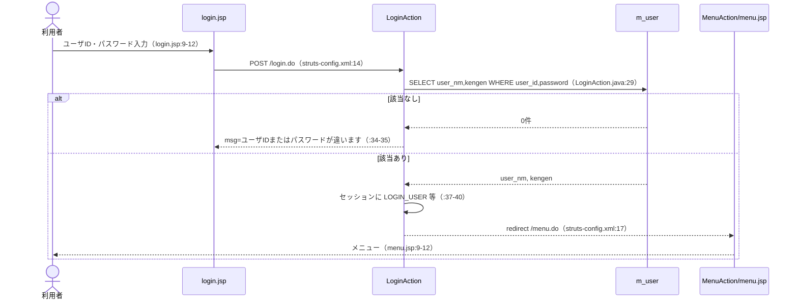
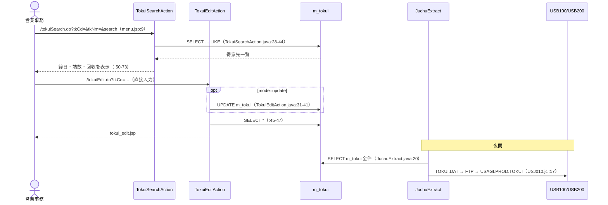
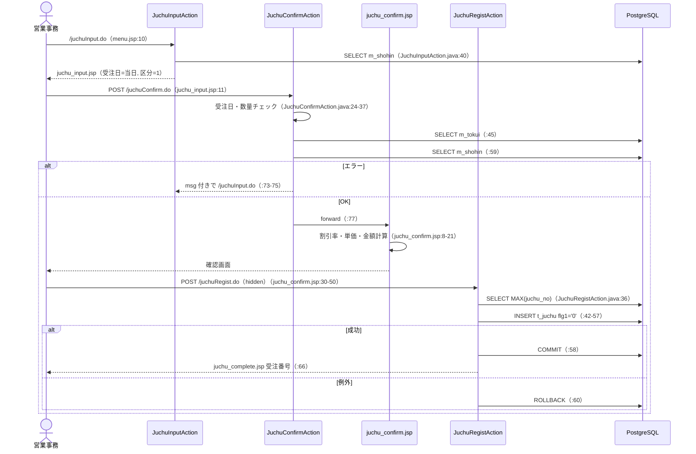
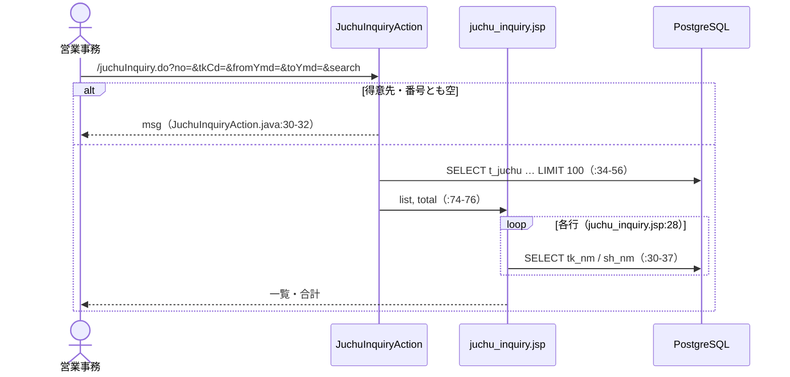
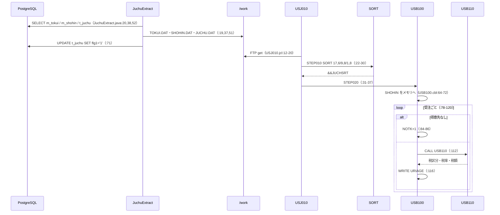
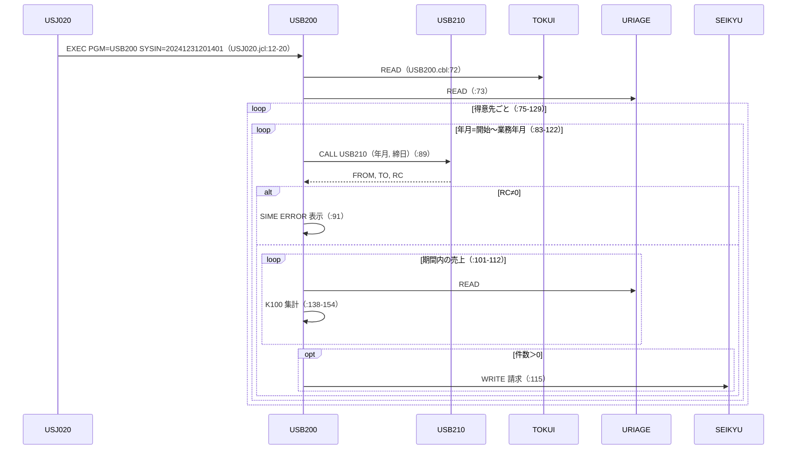
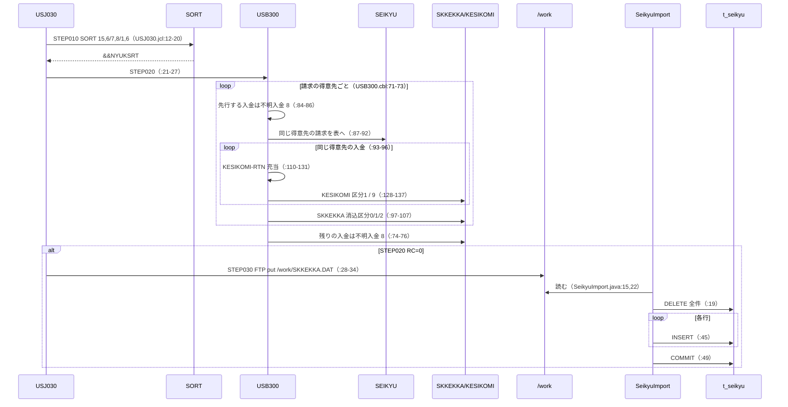
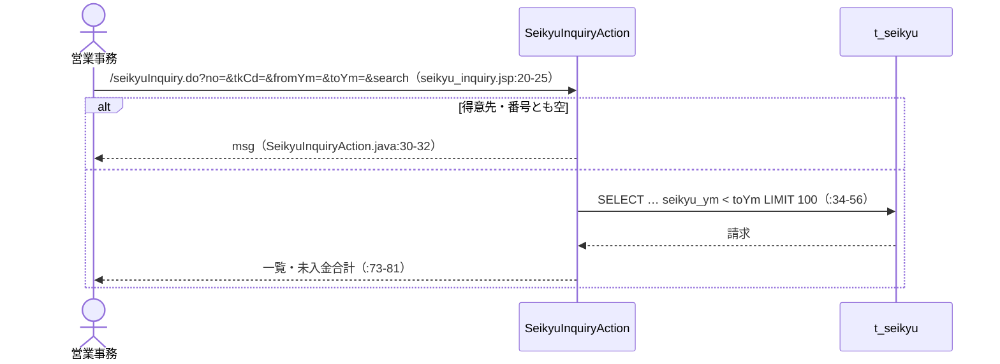
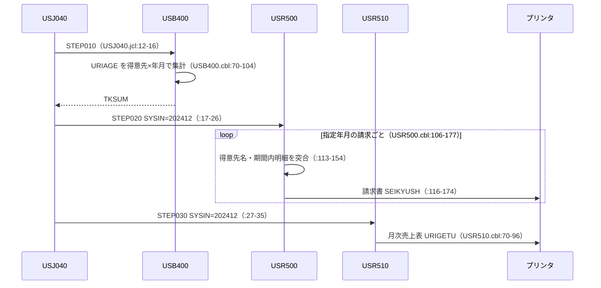

# 04 処理フローシーケンス図（業務イベント単位）

> 凡例：根拠は「ファイル名:行番号」。パスは省略形（例 USB100.cbl＝batch/cobol/USB100.cbl、JuchuRegistAction.java＝web/src/jp/co/usagi/sales/action/JuchuRegistAction.java、02_data.sql＝web/sql/02_data.sql、旧仕様書.xlsx＝docs/旧仕様書.xlsx）。「推定」と書いたものはコードから確定できない記述で、理由を併記する。

## EV01 ログイン・メニュー

## EV02 得意先照会・メンテナンス

## EV03 受注入力

## EV04 受注照会

## EV05 売上計上（受注抽出→売上ファイル作成）

## EV06 月次請求締め

## EV07 入金消込・請求結果連携

## EV08 請求照会

## EV09 月次集計・帳票出力（請求書・月次売上表）

