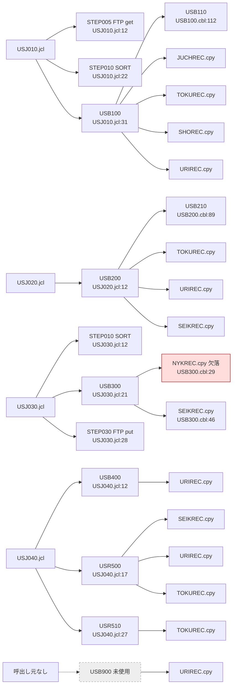
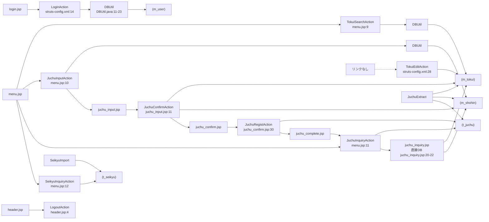

# 05 呼出し関係ツリー図

> 凡例：根拠は「ファイル名:行番号」。パスは省略形（例 USB100.cbl＝batch/cobol/USB100.cbl、JuchuRegistAction.java＝web/src/jp/co/usagi/sales/action/JuchuRegistAction.java、02_data.sql＝web/sql/02_data.sql、旧仕様書.xlsx＝docs/旧仕様書.xlsx）。「推定」と書いたものはコードから確定できない記述で、理由を併記する。

DAO 層はなく、各 Action が DBUtil（接続取得 DBUtil.java:11-23）で直接 SQL を発行する。

## JCL → プログラム → コピー句

| JCL・STEP | プログラム | サブ CALL | コピー句 | DD（ファイル） | 根拠 |
|---|---|---|---|---|---|
| USJ010 STEP005 | FTP |  |  | INPUT（get TOKUI/SHOHIN/JUCHU） | USJ010.jcl:12-20 |
| USJ010 STEP010 | SORT |  |  | SORTIN=JUCHU, SORTOUT=&&JUCHSRT | USJ010.jcl:22-30 |
| USJ010 STEP020 | USB100 | USB110 | JUCHREC, TOKUREC, SHOREC, URIREC | JUCHSRT, TOKUI, SHOHIN, URIAGE | USJ010.jcl:31-37, USB100.cbl:112 |
| USJ020 STEP010 | USB200 | USB210 | TOKUREC, URIREC, SEIKREC | TOKUI, URIAGE, SEIKYU, SYSIN | USJ020.jcl:12-20, USB200.cbl:89 |
| USJ030 STEP010 | SORT |  |  | SORTIN=NYUKIN, SORTOUT=&&NYUKSRT | USJ030.jcl:12-20 |
| USJ030 STEP020 | USB300 |  | NYKREC（欠落）, SEIKREC | NYUKSRT, SEIKYU, SKKEKKA, KESIKOMI | USJ030.jcl:21-27, USB300.cbl:29,46 |
| USJ030 STEP030 | FTP |  |  | put SKKEKKA | USJ030.jcl:28-34 |
| USJ040 STEP010 | USB400 |  | URIREC | URIAGE, TKSUM | USJ040.jcl:12-16 |
| USJ040 STEP020 | USR500 |  | SEIKREC, URIREC, TOKUREC | SKKEKKA, URIAGE, TOKUI, SEIKYUSH, SYSIN | USJ040.jcl:17-26 |
| USJ040 STEP030 | USR510 |  | TOKUREC | TKSUM, TOKUI, URIGETU, SYSIN | USJ040.jcl:27-35 |
| （なし） | USB900 |  | URIREC | URIAGE, URINEW | USB900.cbl:21-23 |

推定：コピー句の利用はソース内の COPY 文による（grep "COPY" batch/cobol/*.cbl の結果）。

## 画面 → Action → DAO（DBUtil）→ テーブル

| 画面（JSP） | URL | Action | 遷移先 | テーブル | 根拠 |
|---|---|---|---|---|---|
| login.jsp | /login.do | LoginAction | menu.do / login.jsp | m_user | struts-config.xml:14-18, LoginAction.java:29 |
| header.jsp | /logout.do | LogoutAction | login.jsp |  | struts-config.xml:19-21, header.jsp:4 |
| menu.jsp | /menu.do | MenuAction | menu.jsp |  | struts-config.xml:22-24 |
| tokui_search.jsp | /tokuiSearch.do | TokuiSearchAction | tokui_search.jsp | m_tokui | struts-config.xml:25-27, TokuiSearchAction.java:28 |
| tokui_edit.jsp | /tokuiEdit.do | TokuiEditAction | tokui_edit.jsp | m_tokui | struts-config.xml:28-30, TokuiEditAction.java:31,45 |
| juchu_input.jsp | /juchuInput.do | JuchuInputAction | juchu_input.jsp | m_shohin | struts-config.xml:31-34, JuchuInputAction.java:40 |
| juchu_input.jsp | /juchuConfirm.do | JuchuConfirmAction | juchu_confirm.jsp / juchuInput.do | m_tokui, m_shohin | struts-config.xml:35-39, JuchuConfirmAction.java:45,59 |
| juchu_confirm.jsp | /juchuRegist.do | JuchuRegistAction | juchu_complete.jsp | t_juchu | struts-config.xml:40-43, JuchuRegistAction.java:36,42 |
| juchu_inquiry.jsp | /juchuInquiry.do | JuchuInquiryAction | juchu_inquiry.jsp | t_juchu（＋JSP で m_tokui, m_shohin） | struts-config.xml:44-46, JuchuInquiryAction.java:34, juchu_inquiry.jsp:21-22 |
| seikyu_inquiry.jsp | /seikyuInquiry.do | SeikyuInquiryAction | seikyu_inquiry.jsp | t_seikyu | struts-config.xml:47-49, SeikyuInquiryAction.java:34 |
