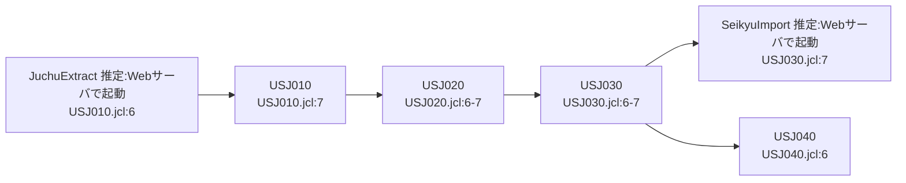

# 07 欠けた資産と復元案

> 凡例：根拠は「ファイル名:行番号」。パスは省略形（例 USB100.cbl＝batch/cobol/USB100.cbl、JuchuRegistAction.java＝web/src/jp/co/usagi/sales/action/JuchuRegistAction.java、02_data.sql＝web/sql/02_data.sql、旧仕様書.xlsx＝docs/旧仕様書.xlsx）。「推定」と書いたものはコードから確定できない記述で、理由を併記する。

| No | 欠けた資産 | 状況 | 影響 | 参照元 | 復元案（根拠） |
|---|---|---|---|---|---|
| M01 | コピー句 NYKREC.cpy（入金レコード定義） | USB300.cbl:28-29 の FD NYFL で COPY NYKREC しているが batch/copy/ に存在しない（batch/copy は JUCHREC/SEIKREC/SHOREC/TOKUREC/URIREC の5本のみ） | 高：USB300 がコンパイルできない | USB300.cbl:29 | JCL の LRECL=60（USJ030.jcl:17）、SORT キー 15,6 / 7,8 / 1,6（USJ030.jcl:19）、参照項目 NY-NO/NY-DATE/NY-TK-CD/NY-KIN/NY-TESURYO（USB300.cbl:111,117,142,149-153,168）、実データ NYUKIN.DAT（650件・60バイト）から下記「復元案」を作成 |
| M02 | Struts メッセージリソース MessageResources.properties | struts-config.xml:51 で参照しているが WEB-INF/classes 等に存在しない（null="true" のため実害は小さい。推定：メッセージは各 Action に直書きのため） | 低 | struts-config.xml:51 | 各 Action の直書きメッセージ（JuchuConfirmAction.java:26-63 等）を集めれば作成可能。現行では不要の可能性が高い（推定） |
| M03 | Web 側バッチの起動定義（JuchuExtract / SeikyuImport を呼ぶシェル・cron・ジョブ定義） | JCL のコメントに先行「Ｗｅｂ 受注抽出（JuchuExtract）」・後続「Ｗｅｂ 請求取込」とあるが、起動する資産がない | 中：連携時刻・順序が分からない | USJ010.jcl:6, USJ030.jcl:7 | JuchuExtract は USJ010 の FTP get（/work/*.DAT USJ010.jcl:17-19）より前、SeikyuImport は USJ030 STEP030 の FTP put（/work/SKKEKKA.DAT USJ030.jcl:33）より後に、Web サーバ上で java -cp … jp.co.usagi.batch.JuchuExtract /work のように起動していたと推定（引数既定値 JuchuExtract.java:14, SeikyuImport.java:15, docker-compose.yml:21） |
| M04 | 入金データ USAGI.PROD.NYUKIN を作成するジョブ（銀行振込データ受信） | USJ030 が USAGI.PROD.NYUKIN を入力するが、作成するJCL・プログラムがない。データ batch/data/NYUKIN.DAT のみ存在 | 中 | USJ030.jcl:14 | 摘要「振込」「振込手数料差引」「一部入金」（NYUKIN.DAT）から、銀行の振込入金明細を60バイトに変換して受信するジョブがあったと推定。旧仕様書にも「銀行振込データ」とある（旧仕様書.xlsx バッチ処理概要!D7） |
| M05 | 消込結果 USAGI.PROD.KESIKOMI の利用先 | USB300 が出力するが、どの JCL・プログラムも読まない。不明入金（8）・過入金（9）を確認する帳票・画面がない | 中 | USJ030.jcl:26, USB300.cbl:34-44 | 推定：経理担当が別システム（またはデータセットの直接閲覧）で確認していた。レイアウトは USB300.cbl:35-44 から確定 |
| M06 | USB900 用の JCL（DD URINEW） | USB900 は URINEW に出力する（USB900.cbl:23）が、URINEW を定義した JCL がない | 低（未使用） | USB900.cbl:21-23 | 1997年の税率改定時に一度だけ実行した臨時ジョブと推定（USB900.cbl:41-46）。復元不要の可能性が高い |
| M07 | データセットの初期作成（割当）とジョブネット定義 | URIAGE/SEIKYU/SKKEKKA/KESIKOMI/TKSUM は DISP=OLD で既存前提だが、割当ジョブがない。USJ010→USJ040 の実行順序はコメントのみでスケジューラ定義がない | 低 | USJ010.jcl:36, USJ020.jcl:16, USJ030.jcl:25-26, USJ040.jcl:15, USJ010.jcl:6-7 | 各 JCL の「先行／後続」コメント（USJ010.jcl:6-7, USJ020.jcl:6-7, USJ030.jcl:6-7, USJ040.jcl:6-7）から下記の順序を復元：JuchuExtract→USJ010→USJ020→USJ030→（SeikyuImport, USJ040） |
| M08 | SYSIN（業務日付・対象年月）の更新手順 | USJ020 の SYSIN が 20241231201401、USJ040 の SYSIN が 202412 と固定値で書かれている。毎回の書き換え手順・パラメタ作成ジョブがない | 中 | USJ020.jcl:18-20, USJ040.jcl:24-25,33-34 | 推定：運用者が月次で JCL を手修正していた（または日付を作る前処理が欠落）。確認事項 Q16 で確認 |

## M01 NYKREC.cpy 復元案

現行リポジトリに NYKREC.cpy は存在しない。以下は JCL・呼出し元・実データから作った**推定**の定義（リポジトリには追加していない）。

```cobol
      *****************************************************************
      *  NYKREC   入金ファイル  レコード長 60 【復元案・現行リポジトリには存在しない】
      *  根拠: USJ030.jcl:17（LRECL=60）, USJ030.jcl:19（SORT 15,6/7,8/1,6）,
      *        USB300.cbl:111,117,142,149-153,168（参照項目）, NYUKIN.DAT:1-650
      *****************************************************************
       01  NY-REC.
           03  NY-NO               PIC 9(06).
           03  NY-DATE             PIC 9(08).
           03  NY-TK-CD            PIC X(06).
           03  NY-KIN              PIC 9(09).
           03  NY-KBN              PIC X(01).
           03  NY-TESURYO          PIC 9(05).
           03  NY-TEKIYO           PIC X(25).
```

| 位置 | 項目 | 型・桁 | 業務名 | 根拠 | 確度 |
|---|---|---|---|---|---|
| 1-6 | NY-NO | 9(06) | 入金番号 | SORT 第3キー 1,6（USJ030.jcl:19）。データ 000001〜000650 の連番（NYUKIN.DAT:1,650）。KS-NY-NO 9(06) へ MOVE（USB300.cbl:36,149） | 確度高 |
| 7-14 | NY-DATE | 9(08) | 入金日 | SORT 第2キー 7,8（USJ030.jcl:19）。SK-TO 9(08) と比較（USB300.cbl:117）。データ 20140930（NYUKIN.DAT:1） | 確度高 |
| 15-20 | NY-TK-CD | X(06) | 得意先コード | SORT 第1キー 15,6（USJ030.jcl:19）。WK-NY-KEY X(06) へ MOVE（USB300.cbl:50,168）。データ 100001 | 確度高 |
| 21-29 | NY-KIN | 9(09) | 入金額 | KS-NY-KIN 9(09) へ MOVE（USB300.cbl:42,152）。データ 000003188 | 確度中（桁はデータと送り先から推定） |
| 30 | NY-KBN | X(01) | 入金区分 | データ全650件が "1"（NYUKIN.DAT）。プログラムでは参照しない。名前・意味は推定 | 確度低（名前・意味） |
| 31-35 | NY-TESURYO | 9(05) | 振込手数料 | KS-TESURYO 9(05) へ MOVE（USB300.cbl:43,153）。データ 00000/00440/00660。摘要「振込手数料差引」の行が 00440/00660 | 確度高 |
| 36-60 | NY-TEKIYO | X(25) | 摘要 | データは「振込」「振込手数料差引」「一部入金」（UTF-8、末尾空白）。プログラムでは参照しない。名前は推定 | 確度中 |

検算：6+8+6+9+1+5+25＝60 バイト（USJ030.jcl:17 の LRECL=60 と一致）。NYUKIN.DAT:1 を当てはめると「000001｜20140930｜100001｜000003188｜1｜00440｜振込手数料差引」。

## M07 ジョブ順序の復元案


